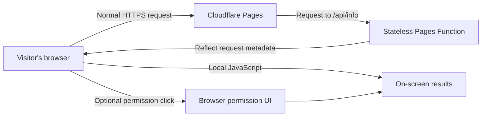

<div align="center">

<a href="https://who.mehrdad32.ir/" title="Explore the live WHO experience">
  
</a>

# WHO — What Happens Online?

**An interactive, open-source journey into what websites can learn from your browser.**

<p><strong>Explore your digital footprint. Understand the signals. Stay in control.</strong></p>

[**🚀 Explore Live Demo**](https://who.mehrdad32.ir/) &nbsp;·&nbsp;
[**🔎 Full Report**](https://who.mehrdad32.ir/full) &nbsp;·&nbsp;
[**⚡ Lite Report**](https://who.mehrdad32.ir/lite) &nbsp;·&nbsp;
[**👤 Creator**](https://mehrdad32.ir/)

**TypeScript** · **React** · **Vite** · **Cloudflare Pages** · **MIT License**

</div>

---

## ✨ What is WHO?

**WHO (What Happens Online?)** turns browser privacy into an experience anyone can understand.

Visit the site, discover what a webpage can infer **without requesting permission**, and—only if you choose—explore what additional capabilities require your approval. Each discovery includes a plain-language explanation and a link to learn more.

The experience is **Persian-first (RTL)**, mobile-friendly, and built around one principle: **educate without tracking visitors**.

> [!IMPORTANT]
> **WHO is an educational tool, not a fingerprinting or tracking service.** The application does not maintain visitor profiles, store experiment results, or transmit locally collected browser signals to its backend. Normal network requests still reach the hosting provider; see [Privacy & transparency](#-privacy--transparency).

## 🧭 Choose your experience

| Route | Experience | What you'll see |
|:---|:---|:---|
| [`/`](https://who.mehrdad32.ir/) | **Interactive journey** | A guided story with discoveries, optional permission tests, progress, and a shareable ending |
| [`/full`](https://who.mehrdad32.ir/full) | **Full report** | A searchable view of available HTTP request metadata and browser-side signals |
| [`/lite`](https://who.mehrdad32.ir/lite) | **Lite report** | Your public IP, detected browser/version, operating system, and device category |

### Designed to be explored

- **Discover, don't guess.** Understand which data is part of an HTTP request and which values JavaScript can access locally.
- **Permissions are opt-in.** Sensitive capabilities are demonstrated only after an explicit tap or click; visitors can skip them.
- **Learn as you go.** Each item includes a short explanation and an external reference.
- **One experience, every screen.** Responsive layouts, motion-aware transitions, accessible progress indicators, and a locally bundled **Vazirmatn** font.
- **Easy to share.** Native sharing when available, with a copy-link fallback.
- **No account required.** No signup, dashboard, or database.

## 🔒 Privacy & transparency

The **WHO application itself** does not use analytics scripts, third-party trackers, tracking cookies, visitor accounts, a database, or persistent client-side profiles.

| Data / action | Where it is handled | Stored or uploaded by WHO? |
|---|---|---|
| Initial HTTPS requests and request headers | Cloudflare receives them to serve the website | **Not stored by application code** |
| Public IP and coarse IP-based location | Reflected by the stateless `/api/info` endpoint from the request already received | **Not persisted by WHO** |
| Browser, display, device hints, Canvas/Audio demonstrations | Computed in the visitor's browser | **Not uploaded** |
| Camera, microphone, screen, NFC and other permission demonstrations | Initiated by an explicit user action, where supported | **No content uploaded or saved** |
| Share button and educational links | Activated only when the visitor chooses | **No WHO tracking** |

**Hosting-provider distinction:** Cloudflare necessarily processes network traffic and may retain security or operational logs according to the site owner's account settings and Cloudflare policies. A self-hosted deployment may have different logging behavior. WHO makes **no claim** that third-party infrastructure never processes or logs network metadata.

The IP-based location is approximate; a VPN, proxy or mobile operator can change it. Browser versions, hardware information and fingerprint-like signals may be incomplete or deliberately reduced by privacy protections.

### How the data flows



**No visitor database, tracking pixel, or experiment-result collection pipeline.**

## 🌐 Why WHO may show a different IP than another website

WHO deliberately reports the **IP that Cloudflare sees when your browser requests WHO**, read from the trusted `CF-Connecting-IP` header in its stateless Pages Function. It does **not** claim to discover a separate ISP-assigned address behind your network, a VPN, proxy, corporate gateway or upstream relay. In such configurations, other IP-checking sites can report different egress addresses; neither value should automatically be called a bug.

To diagnose a mismatch without any automatic third-party requests:

1. Open WHO's [Lite view](https://who.mehrdad32.ir/lite) and note the **IP seen by WHO**.
2. From the same browser and connection settings, open [Cloudflare trace on WHO's own domain](https://who.mehrdad32.ir/cdn-cgi/trace) and compare its `ip=` line; this endpoint is provided by Cloudflare, not the WHO app.
3. Optionally open an **independent** IP checker in a separate tab (this sends a request to that service only when you open it), and compare the results.
4. Check VPN/proxy rules and per-site routing, then refresh all pages. A difference can also be due to IPv4/IPv6 preference, carrier gateways or network path changes.

The app intentionally does **not** contact third-party IP services or process untrusted `X-Forwarded-For` claims to force agreement. Cloudflare's documented `CF-Connecting-IP` semantics are the source of truth **for this site's incoming request only**. If a Cloudflare transform removes or rewrites that header, investigate the zone's rules rather than guessing a replacement address.

## 🛠 Run locally

**Prerequisites:** Node.js and npm compatible with the versions specified in [`package.json`](package.json).

```bash
git clone https://github.com/Mehrdad32/Who.git
cd Who
npm install
npm run dev
```

Open the local URL reported by Vite.

```bash
npm run check
npm run build
npm run preview
```

> [!NOTE]
> `npm run dev` runs the Vite front end, **not** Cloudflare Pages Functions. The public IP and Cloudflare request metadata require a Pages-compatible environment; without one, these fields can appear unavailable.

To test the built site together with its Pages Function locally, you can use Cloudflare's Wrangler CLI:

```bash
npm run build
npx wrangler pages dev dist
```

## ☁️ Deploy your own copy to Cloudflare Pages

You **do not** need to use the original project's GitHub account, domain, or Cloudflare Pages project name.

1. **Fork** [this repository](https://github.com/Mehrdad32/Who/fork) into **your own GitHub account** (or push a clone to a repository you control).
2. In your Cloudflare dashboard, create a **Pages** project using **Git integration** and select **your fork**.
3. Configure the production branch and build settings:

   | Setting | Value |
   |---|---|
   | Repository | `YOUR_GITHUB_USERNAME/YOUR_REPOSITORY` |
   | Production branch | `main` (or your repository's default branch) |
   | Framework preset | `Vite` |
   | Build command | `npm run build` |
   | Build output directory | `dist` |
   | Root directory | Repository root |

4. Deploy. Cloudflare Pages should discover [`functions/api/info.ts`](functions/api/info.ts) as a Pages Function. The [`public/_routes.json`](public/_routes.json) file limits Function invocation to the API path.
5. Open **your own** `*.pages.dev` URL and test `/`, `/full`, `/lite`, and `/api/info`.
6. **Optional:** Add a custom domain **that you control**, such as `who.example.com`, in **Pages → Custom domains** and follow the DNS instructions shown for your deployment.

**For deployments handling visitor metadata:** keep the `/api/info` response non-cacheable (`Cache-Control: no-store`) and avoid adding Cloudflare Web Analytics, Zaraz, client-side analytics, or custom request logging if you want to preserve this project's privacy-first behavior.

> **Original demo:** [who.mehrdad32.ir](https://who.mehrdad32.ir/) is the author's public instance—not a required deployment domain. Likewise, the original repository `Mehrdad32/Who` is the source you fork, not the repository you select in your own Cloudflare account.

## 🧱 Technology

| Layer | Technology |
|---|---|
| Front end | React, TypeScript, Vite |
| UI | Responsive CSS, Lucide icons, Vazirmatn (self-hosted font assets) |
| Browser experiments | Standard browser Web APIs |
| Server-side metadata | Stateless Cloudflare Pages Function |
| Hosting | Cloudflare Pages; source hosted on GitHub |

## 🧪 Browser support & boundaries

Most basic observations work in modern browsers; results depend on the browser, operating system, permissions, HTTPS context and privacy settings.

- **Web NFC is NDEF-oriented**, not raw ISO-DEP/APDU access. WHO cannot communicate directly with an ePassport chip through Web NFC.
- Camera, microphone, geolocation, screen capture, device chooser APIs and other demonstrations may be unavailable or previously permitted/denied.
- Fingerprint-like results are **not reliable proof of identity** and are not guaranteed to be unique or stable.
- The **Lite** view avoids the broader browser-metric collection used by the full experience.

## 🤝 Contributing

Contributions are welcome: accessibility improvements, better educational explanations, translations, browser compatibility fixes and privacy-preserving features.

1. Fork the project and create a descriptive branch.
2. Keep the no-tracking, no-storage principles intact.
3. Run `npm run check` and `npm run build`.
4. Open a pull request describing the change and how you tested it.

For bugs or feature requests, use [GitHub Issues](https://github.com/Mehrdad32/Who/issues). Please **do not post personal IP addresses, device identifiers, or other sensitive information** in public reports.

## 📄 License & attribution

The application source code is licensed under [MIT](LICENSE). Vazirmatn font assets are distributed under their own [SIL Open Font License](https://scripts.sil.org/OFL); third-party dependencies retain their respective licenses.

---

<div align="center">

**WHO — What Happens Online?**

*Know what your browser reveals. Choose what you share.*

Made with care by **[Mehrdad32](https://mehrdad32.ir/)**

[Live demo](https://who.mehrdad32.ir/) · [GitHub repository](https://github.com/Mehrdad32/Who) · [Report an issue](https://github.com/Mehrdad32/Who/issues)

</div>
